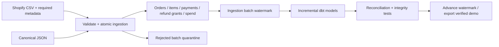

# MerchantOps

**Explain why store contribution changed—and reconcile what was actually collected or refunded.**

[Public demo](https://merchantops-sarfaraz-demo.calmcat128.chatgpt.site/) · [Integration contract](docs/integration.md) · [Metric decisions](docs/decisions.md) · [Tests](tests/) · [Merchant value assessment](docs/product-assessment.md) · [Measured benchmark](docs/benchmark.json)

MerchantOps is a local batch analytics system for commerce operators. It separates orders, line items, refund grants and payment events, so multiple items or split payments cannot multiply sales. It reports contribution, SKU refund exposure, observed repeat purchase and cash collection/refund liabilities.

**Status:** tested canonical JSON importer, a restricted offline Shopify CSV adapter, and incremental dbt transformations. The public demo is a generated, read-only synthetic snapshot. No real merchant is connected; Shopify compatibility is tested against synthetic fixtures shaped from its documentation, not a merchant-supplied export. No business uplift or universal integration claim is made.

## What to inspect in 90 seconds
1. Filter a channel and inspect the contribution bridge: gross sales, discounts, refunds, item costs, shipping, actual payment fees and ads.
2. Open SKU returns. Merchandise contribution excludes shared order/channel costs; those are accounted for in the financial ledger.
3. Inspect payment reconciliation. A refund grant reduces revenue; returning its cash clears a liability, without reducing revenue twice.
4. Follow “One refund. Counted once.” Each step explains what happened, the calculation, expected versus actual results, and the merchant’s next action. Refund payment and advertising are separate steps.
5. Inspect the real dbt integration test: a historical refund/backdated spend updates old partitions and matches a full rebuild.

## Quickstart — Python 3.13, macOS or Linux
Run from this repository. The CLI has no network or API-key dependency after installation.
```sh
python3 -m venv .venv
source .venv/bin/activate
pip install -r requirements.txt
python -m pytest -q
python -m merchantops.build
python -m merchantops.benchmark --orders 100000 --repeats 3
python -m merchantops.publishing
python -m http.server 8000 --directory dist
```
Open http://localhost:8000. `build` recreates only the synthetic `merchantops-v3.duckdb` in an isolated workspace, runs dbt and its checks, and exports the demo. It does not process your store database. The full benchmark launches real dbt and can take a few minutes; it is not required for store ingestion.

## Shopify CSV adapter — supported profile 1

Read the [exact support matrix and export instructions](docs/shopify.md) first. The adapter accepts paid, unrefunded INR orders with unique SKUs per order and successful sale/capture transactions. It requires historical item costs, fulfilment costs, actual payment fees, stable provider transaction IDs and pseudonymous customer IDs. Unsupported taxes, discounts, shipping income and refunds are rejected, never silently omitted.

```sh
python -m merchantops.shopify run --orders examples/shopify/orders.csv --transactions examples/shopify/transactions.csv --context examples/shopify/context.json --database shopify-demo.duckdb --as-of 2026-06-30 --report-dir store-reports/shopify
```
Expected synthetic result: ₹130 revenue − ₹40 COGS − ₹5 fulfilment − ₹2.60 fees = **₹82.40 contribution before advertising**. Both captures reconcile to ₹130. Repeating the command inserts zero records. This is a working offline adapter, not an installed Shopify app or a live API connector.

## Try the working integration contract
These named-field JSON fixtures model a ₹130 merchandise order with ₹10 discount, ₹40 COGS, ₹5 shipping and ₹2.40 successful payment fees. Two items and two captures must produce exactly ₹72.60 contribution.
```sh
python -m merchantops run --input examples/store_batch.json --database store.duckdb --as-of 2026-06-30
python -m merchantops run --input examples/late_refund.json --database store.duckdb --as-of 2026-06-30
python -m merchantops run --input examples/late_refund.json --database store.duckdb --as-of 2026-06-30
python -m merchantops run --input examples/refund_paid.json --database store.duckdb --as-of 2026-06-30 --report-dir store-reports
```
Expected contribution: ₹72.60 → ₹52.60 → ₹52.60 → ₹42.60. The final step returns ₹20 refund cash and adds ₹10 advertising. Refund cash does not reduce revenue again. Repeating any successful bundle reports zero inserted rows. The last command writes local CSV decision tables and `summary.json` to `store-reports/`; these files are ignored by Git and never deployed. Inspect `payment_reconciliation`, `monthly`, `line_economics` and `quarantine` in `store.duckdb`.

Each order must initially arrive with at least one line; the source mapper must verify completeness. Additional distinct immutable lines can arrive later. Captures/refund grants/refund payments can arrive later. Failed payments are recorded but contribute no cash or fee. Unknown fields, currencies, invalid references and conflicting IDs fail closed. [Read the mapping and operating contract before using real data.](docs/integration.md)

## Architecture and reasoning

Five models use dbt `delete+insert` keyed replacements: line economics, order economics, payment reconciliation, monthly channel totals and SKU totals. Late events select affected historical keys using ingestion sequence numbers, not `max(event_date)`. Retention and acquisition summaries rebuild deliberately to handle historical first purchases. The watermark advances only after the complete dbt build succeeds. On failure, retry the same batch; do not export partial mart state.

## Evidence, not claims
The benchmark uses 100,000 synthetic orders with separate line items and payment events, three fresh processes per mode. It records workload/code/dependency hashes, per-phase dbt results, wall time and individual-process peak RSS. Every final model is compared by sorted output hash and contribution is checked independently in Python.

Full mode performs one build. Incremental mode performs initial, delta and duplicate-replay builds. Total times do **not** establish an incremental speedup. Peak memory is the largest individual process high-water mark, not concurrent aggregate usage. See [verification](docs/verification.md).

## Supported boundaries
One store/database, INR paise, immutable accepted sales and terminal payment events, calendar dates, one writer, local batch execution. No tax, shipping income, chargebacks, inventory recovery, historical cost corrections, partial cancellations, FX or hosted mutable API. Shipping and fees are never arbitrarily allocated to SKUs. Platform API authentication/pagination and change capture remain unimplemented. The Shopify CSV profile has narrower limits than the canonical schema; see its support matrix. This is not a Shopify/WooCommerce plug-in.

Version 3 uses a new database path and rejects the legacy single-product schema; it does not silently migrate it. Keep legacy data and map it to the named contract before importing into a new store database.

## Ownership and use
Sarfaraz Nawas supplied the commerce domain, priorities and publication decisions. Implementation was AI-assisted. This repository demonstrates executable behavior, not proof of unaided proficiency; [the interview guide](docs/interview.md) includes exercises to establish that understanding. Synthetic inputs are generated by `merchantops.core.synthetic` with seed 42. No employer/client records or credentials are included. No third-party transaction dataset is redistributed.

Technical references: [dbt incremental models](https://docs.getdbt.com/docs/build/incremental-models), [DuckDB COPY](https://duckdb.org/docs/current/sql/statements/copy). Dependency versions are pinned in `requirements.txt`.
